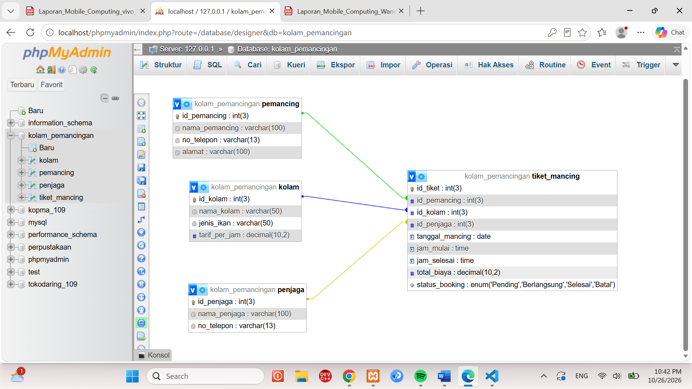

# LAPORAN PRAKTIKUM BASIS DATA / MODUL PERANCANGAN BASIS DATA
* **Nama:** Wanda Talia
* **Kelas:** D
* **NIM:** 25430109
* **Hari/Tanggal:** Senin, 26 Oktober 2026

### 1. Tujuan Praktikum
Praktikum ini bertujuan untuk memahami dan mengimplementasikan perancangan basis data relasional secara visual menggunakan antarmuka grafis phpMyAdmin. Fokus utamanya adalah merancang struktur tabel, menentukan relasi antar entitas, serta menetapkan tipe data dan *constraint* yang tepat pada studi kasus sistem pemesanan tiket kolam pemancingan.
Berikut adalah poin-poin penting yang dipelajari selama praktikum:
* **Pengenalan Desainer Basis Data:** Memanfaatkan fitur *Designer* pada phpMyAdmin untuk melihat, memetakan, dan menghubungkan relasi antar tabel secara visual.
* **Penerapan Relasi Antar Tabel:** Menghubungkan tabel utama (`pemancing`, `kolam`, `penjaga`) dengan tabel transaksional (`tiket_mancing`) menggunakan kunci tamu (*Foreign Key*).
* **Pemilihan Tipe Data & Constraint:** Mengatur tipe data yang sesuai (`INT`, `VARCHAR`, `DATE`, `TIME`, `DECIMAL`, `ENUM`) serta *constraint* seperti `PRIMARY KEY` dan `FOREIGN KEY` agar integritas data tetap terjaga.

### 2. Ringkasan Dasar Teori
Basis data relasional digunakan untuk mengelola data yang saling terhubung secara terstruktur. Dalam studi kasus sistem kolam pemancingan, data dibagi menjadi beberapa entitas untuk menghindari redundansi data:
* **Entitas `pemancing`**: Menyimpan data identitas pelanggan atau pemancing yang berkunjung.
* **Entitas `kolam`**: Menyimpan informasi mengenai jenis kolam, jenis ikan, serta tarif per jam.
* **Entitas `penjaga`**: Menyimpan data petugas atau penjaga yang bertugas.
* **Entitas `tiket_mancing`**: Tabel transaksi yang menghubungkan data pemancing, kolam, dan penjaga, serta mencatat jadwal dan status pemesanan.

Untuk memastikan konsistensi relasi, perhatikan komponen penting berikut:
* **Primary Key (PK):** Kolom unik yang menjadi pengenal utama setiap baris data (contoh: `id_pemancing`, `id_kolam`, `id_penjaga`, `id_tiket`).
* **Foreign Key (FK):** Kolom penghubung yang mereferensikan *Primary Key* dari tabel lain (contoh: `id_pemancing`, `id_kolam`, dan `id_penjaga` di dalam tabel `tiket_mancing`).
* **Tipe Data & Enum:** Penggunaan tipe data khusus seperti `DECIMAL` untuk perhitungan biaya, `DATE` dan `TIME` untuk penjadwalan, serta `ENUM` untuk status pemesanan yang terbatas (seperti *'Pending'*, *'Berlangsung'*, *'Selesai'*, *'Batal'*).

### 3. Hasil Langkah Percobaan (Tangkapan Layar, Keterangan)
#### a. Tahap Perancangan Struktur Database di phpMyAdmin
* **Keterangan:** Tampilan antarmuka *Designer* pada database `kolam_pemancingan` di phpMyAdmin. Memperlihatkan skema relasi secara visual antara tabel `pemancing`, `kolam`, `penjaga`, dan tabel transaksi `tiket_mancing`.

#### b. Struktur Tabel dan Kolom
* **Tabel `pemancing`:**
  * `id_pemancing` (INT(3), Primary Key)
  * `nama_pemancing` (VARCHAR(100))
  * `no_telepon` (VARCHAR(13))
  * `alamat` (VARCHAR(100))
* **Tabel `kolam`:**
  * `id_kolam` (INT(3), Primary Key)
  * `nama_kolam` (VARCHAR(50))
  * `jenis_ikan` (VARCHAR(50))
  * `tarif_per_jam` (DECIMAL(10,2))
* **Tabel `penjaga`:**
  * `id_penjaga` (INT(3), Primary Key)
  * `nama_penjaga` (VARCHAR(100))
  * `no_telepon` (VARCHAR(13))
* **Tabel `tiket_mancing` (Tabel Transaksi):**
  * `id_tiket` (INT(3), Primary Key)
  * `id_pemancing` (INT(3), Foreign Key)
  * `id_kolam` (INT(3), Foreign Key)
  * `id_penjaga` (INT(3), Foreign Key)
  * `tanggal_mancing` (DATE), `jam_mulai` (TIME), `jam_selesai` (TIME)
  * `total_biaya` (DECIMAL(10,2))
  * `status_booking` (ENUM: 'Pending', 'Berlangsung', 'Selesai', 'Batal')

### 4. Jawaban Titik Analisis
* **Titik Analisis 1: Penggunaan Fitur Designer phpMyAdmin**
  * **Kelebihan:** Membantu pengembang melihat gambaran besar (*big picture*) arsitektur database secara intuitif, memudahkan pelacakan relasi antar tabel (*foreign key relationships*), serta mendeteksi kesalahan perancangan relasi secara langsung sebelum data dimasukkan.
* **Titik Analisis 2: Pemilihan Tipe Data `DECIMAL` vs `FLOAT` untuk Tarif dan Biaya**
  * Mengapa menggunakan `DECIMAL(10,2)` dibanding `FLOAT`? Karena `DECIMAL` menyimpan nilai eksak (presisi tinggi), yang sangat krusial dalam pencatatan keuangan, tarif, dan total biaya transaksi agar tidak terjadi pembulatan desimal yang merugikan.
* **Titik Analisis 3: Penggunaan Tipe Data `ENUM` pada `status_booking`**
  * **Alasan:** Kolom `status_booking` hanya memerlukan opsi nilai yang sudah pasti dan terbatas (seperti *'Pending'*, *'Berlangsung'*, *'Selesai'*, *'Batal'*). Penggunaan `ENUM` memastikan bahwa database menolak input data di luar pilihan tersebut sehingga validitas status transaksi tetap terjaga.

### 5. Tugas Mandiri & Milestone Proyek
* **Deskripsi Milestone:** 
  * Berhasil merancang database sistem informasi penyewaan dan pemesanan tiket kolam pemancingan (`kolam_pemancingan`) yang mencakup entitas utama pelanggan, fasilitas kolam, petugas penjaga, hingga tabel transaksional pemesanan lengkap dengan pembatasan relasi (*foreign key constraints*).

### 6. Pembahasan dan Kendala
* **Pembahasan:** Perancangan menggunakan fitur *Designer* phpMyAdmin mempermudah visualisasi relasi *One-to-Many* antara tabel referensi (`pemancing`, `kolam`, `penjaga`) terhadap tabel operasional (`tiket_mancing`). Pengaturan tipe data seperti `DECIMAL` untuk tarif dan `ENUM` untuk status terbukti efektif menjaga konsistensi integritas data transaksional.
* **Kendala dan Solusi:**
  * *Kendala:* Saat membuat relasi *Foreign Key*, terkadang terjadi kesalahan tipe data antar kolom yang direferensikan (misalnya perbedaan panjang atau atribut *unsigned*).
  * *Solusi:* Memastikan kesesuaian tipe data secara presisi (seperti sama-sama menggunakan `INT(3)`) sebelum menghubungkan garis relasi pada menu *Relation View* phpMyAdmin.

### 7. Kesimpulan
* Perancangan basis data `kolam_pemancingan` berhasil diselesaikan dengan baik menggunakan bantuan antarmuka phpMyAdmin. Implementasi kunci primer, kunci tamu, serta tipe data yang spesifik memastikan sistem dapat berjalan secara konsisten, terstruktur, dan siap diintegrasikan ke dalam aplikasi pengelolaan pemancingan berbasis web maupun seluler.

### 8. Pernyataan Penggunaan AI
*Dengan ini saya menyatakan bahwa saya menggunakan* bantuan Artificial Intelligence sebagai alat bantu referensi penyusunan format laporan dan penulisan sintaks SQL, *dengan tetap bertanggung jawab penuh atas seluruh isi, analisis, dan struktur basis data yang dibuat.*

### 9. Bukti Git
* **Link Repositori:** [https://github.com/wandatalia/basisdata_25430109]
