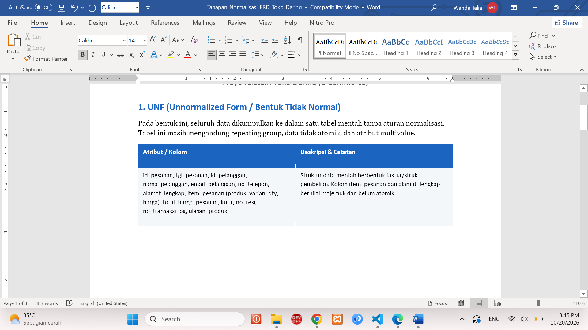
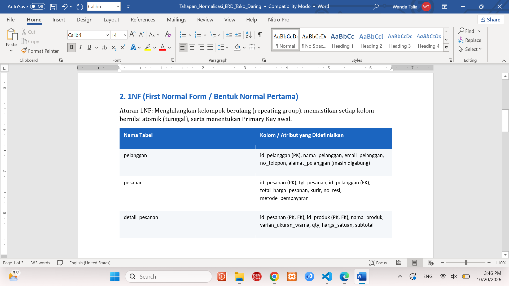
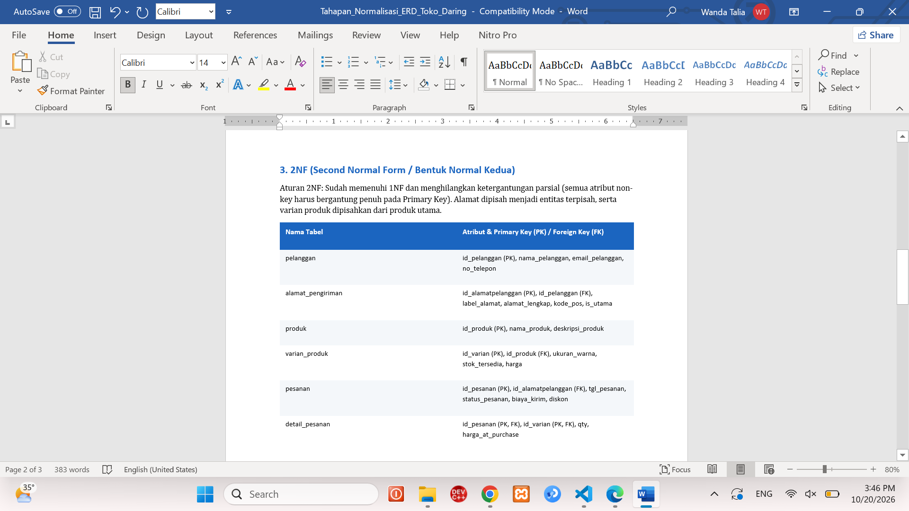
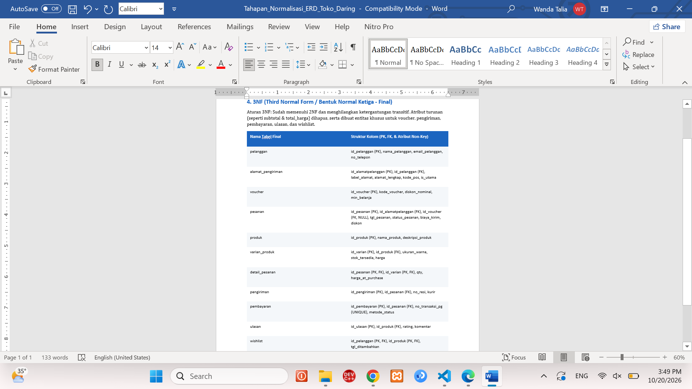

# Laporan Praktikum Basis Data - Pertemuan 04

**Nama:** **Wanda Talia**  
**NIM:** **25430109**    
**Kelas:** **D**    
**Tanggal:** **16 Oktober 2026**

### 1. Tujuan Praktikum
Di pertemuan ini saya berlatih:
1. mencari anomali ubah, sisip, dan hapus pada data yang masih menumpuk di satu tabel;
2. menulis dependensi fungsional (FD) berdasarkan aturan bisnis, bukan dari isi contoh data;
3. memecah tabel dari UNF sampai 3NF, lalu mengecek BCNF;
4. menentukan nilai hasil hitungan (subtotal, total, dan sejenisnya) sebaiknya disimpan atau dihitung saja.

### 2. Ringkasan Dasar Teori
Kalau semua data ditulis dalam satu tabel besar, data yang sama akan terulang di banyak baris. Akibatnya ada tiga masalah. Pertama, **anomali ubah**: satu fakta diperbaiki di satu baris tapi baris lain tertinggal, sehingga datanya bertentangan (misalnya "Budi S." dan "Budi Santoso"). Kedua, **anomali sisip**: suatu data belum bisa dicatat karena data lain belum ada. Ketiga, **anomali hapus**: menghapus satu baris ikut menghilangkan informasi lain yang masih dibutuhkan.

Untuk mencegahnya dipakai dependensi fungsional. `A -> B` artinya satu nilai A pasti hanya punya satu nilai B. FD saya turunkan dari aturan bisnis, karena contoh data hanya bisa menunjukkan FD itu salah, tidak bisa membuktikan FD itu benar.

Normalisasi dilakukan bertahap. 1NF: tidak ada sel berisi daftar atau grup yang berulang. 2NF: tidak ada atribut yang cukup bergantung pada sebagian kunci komposit. 3NF: tidak ada rantai A -> B -> C antar atribut non-kunci. BCNF: setiap penentu harus berupa kunci kandidat. Tujuannya menghilangkan anomali, bukan sekadar menambah jumlah tabel.

### 3. Hasil Langkah Percobaan
### 3.1 Identifikasi anomali pada spreadsheet lama (Gambar 4.1)

| no_nota | tgl | kasir | anggota | barang | qty | harga | pemasok_brg |
|---|---|---|---|---|---|---|---|
| PJ-0142 | 24/09 | Rina | Budi S. | Pulpen Gel 0.5 | 3 | 4000 | CV Sumber ATK |
| PJ-0142 | 24/09 | Rina | Budi S. | Buku Tulis 58 | 2 | 6500 | CV Sumber ATK |
| PJ-0143 | 24/09 | Rina | - | Roti Cokelat | 1 | 5000 | UD Segar |
| PJ-0150 | 25/09 | Rina | Budi Santoso | Pulpen Gel 0.5 | 1 | 4500 | CV. Sumber A.T.K |


| Anomali | Bukti pada data |
|---|---|
| Ubah | Anggota yang sama tertulis "Budi S." (PJ-0142) dan "Budi Santoso" (PJ-0150). Pemasok yang sama tertulis "CV Sumber ATK" dan "CV. Sumber A.T.K". Memperbaiki satu nama berarti mengubah banyak baris. |
| Sisip | Barang baru (misalnya pensil) belum bisa dicatat sebelum ada penjualannya, karena baris hanya lahir dari nota. |
| Hapus | Menghapus PJ-0143 (satu-satunya baris Roti Cokelat) ikut menghapus informasi bahwa pemasoknya UD Segar. |

### 3.2 UNF ke 1NF
**UNF** (grup berulang barang dalam satu nota):

```
NOTA_UNF (no_nota_penjualan, tgl_penjualan, kode_petugas, nama_petugas,
          no_anggota, nama_anggota,
          { kode_barang, nama_barang, qty_detail_penjualan,
            harga_satuan_detail_penjualan, subtotal_detail_penjualan },
          jumlah_penjualan, diskon_penjualan, total_penjualan)
```

**1NF** (satu baris per barang per nota; kunci primer komposit):

```
NOTA_1NF (no_nota_penjualan, kode_barang, tgl_penjualan, kode_petugas,
          nama_petugas, no_anggota, nama_anggota, nama_barang,
          qty_detail_penjualan, harga_satuan_detail_penjualan,
          subtotal_detail_penjualan, jumlah_penjualan, diskon_penjualan,
          total_penjualan)
PK = (no_nota_penjualan, kode_barang)
```

### 3.3 Dependensi fungsional (diturunkan dari aturan bisnis Pertemuan 2)
| Kode | Dependensi fungsional | Dasar |
|---|---|---|
| FD1 | no_nota_penjualan -> tgl_penjualan, kode_petugas, no_anggota | AB-01 (satu nota satu nomor unik, satu tanggal, satu petugas, satu anggota/umum) |
| FD2 | kode_petugas -> nama_petugas | satu kode petugas milik satu orang |
| FD3 | no_anggota -> nama_anggota | AB-05 |
| FD4 | kode_barang -> nama_barang | satu kode satu barang |
| FD5 | (no_nota_penjualan, kode_barang) -> qty_detail_penjualan, harga_satuan_detail_penjualan | AB-04 (harga disimpan per baris nota) |
| FD6 | qty_detail_penjualan, harga_satuan_detail_penjualan -> subtotal_detail_penjualan | turunan (hitungan) |

FD yang **ditolak**: `kode_barang -> harga_satuan_detail_penjualan`. Alasannya AB-04: harga di nota bisa berbeda dari harga barang saat ini.

### 3.4 Menuju 2NF
Kunci tabelnya komposit (no_nota_penjualan, kode_barang), jadi saya cari atribut yang cukup ditentukan oleh salah satu bagian kunci:

- FD1 cukup ditentukan `no_nota_penjualan`, jadi saya pisah menjadi **penjualan**.
- FD4 cukup ditentukan `kode_barang`, jadi saya pisah menjadi **barang**.
- FD5 butuh seluruh kunci, jadi tetap di **detail_penjualan**.

```
PENJUALAN (no_nota_penjualan, tgl_penjualan, kode_petugas, nama_petugas,
           no_anggota, nama_anggota, jumlah_penjualan, diskon_penjualan,
           total_penjualan)
BARANG (kode_barang, nama_barang)
DETAIL_PENJUALAN (no_nota_penjualan, kode_barang, qty_detail_penjualan,
                  harga_satuan_detail_penjualan, subtotal_detail_penjualan)
```

### 3.5 Menuju 3NF
Di PENJUALAN ada dua rantai A → B → C:

- no_nota_penjualan -> kode_petugas -> nama_petugas (FD1 + FD2)
- no_nota_penjualan -> no_anggota -> nama_anggota (FD1 + FD3)

Karena itu **petugas** dan **anggota** saya pisah menjadi tabel sendiri.

### 3.6 Keputusan nilai turunan
| Nilai | Keputusan | Alasan |
|---|---|---|
| subtotal_detail_penjualan | Tidak disimpan | = qty x harga satuan; bila qty/harga dikoreksi, nilai tersimpan bisa tidak cocok |
| jumlah_penjualan | Tidak disimpan | = jumlah subtotal seluruh detail nota |
| diskon_penjualan | Tidak disimpan | ditentukan status anggota (AB-02: 5% bila aktif) |
| total_penjualan | Tidak disimpan | = jumlah - diskon |
| bayar_penjualan | **Disimpan** | uang yang benar-benar diterima kasir; bukan hasil hitungan |

### 3.7 Hasil akhir 3NF
```
PENJUALAN (no_nota_penjualan, tgl_penjualan, kode_petugas*, no_anggota*, bayar_penjualan)
DETAIL_PENJUALAN (no_nota_penjualan*, kode_barang*, qty_detail_penjualan, harga_satuan_detail_penjualan)
BARANG (kode_barang, nama_barang, kategori_barang, harga_jual_barang, stok_barang, stok_min_barang)
PETUGAS (kode_petugas, nama_petugas, peran_petugas)
ANGGOTA (no_anggota, nim_anggota, nama_anggota, prodi_anggota, no_hp_anggota, status_anggota, tgl_daftar_anggota)
-- PK dicetak sebagai kolom pertama (atau gabungan), * = kunci tamu
```

**Tabel tahapan (untuk tangkapan layar bukti):**

| Tahap | Relasi hasil | Masalah yang dihilangkan |
|---|---|---|
| UNF | NOTA_UNF | - (grup berulang barang) |
| 1NF | NOTA_1NF (PK komposit) | grup berulang |
| 2NF | PENJUALAN, BARANG, DETAIL_PENJUALAN | ketergantungan parsial (FD1, FD4) |
| 3NF | PENJUALAN, DETAIL_PENJUALAN, BARANG, PETUGAS, ANGGOTA | ketergantungan transitif (FD2, FD3) + nilai turunan dibuang |

*** tangkapan layar UNF ***


*** tangkapan layar 1NF ***


*** tangkapan layar 2NF ***


*** tangkapan layar 3NF ***



### 3.8 Pencocokan dengan skema kanonik Kopma (Tabel 4.2) dan pemeriksaan BCNF

Beda utamanya dengan hasil saya: skema kanonik memakai **kunci pengganti `id_*`** sebagai kunci primer, sedangkan kode alami (`kode_petugas`, `no_anggota`, `nim_anggota`, `kode_barang`, `no_nota_penjualan`) dijadikan **kunci unik**. Skema kanonik juga punya pemasok, pembelian, dan detail_pembelian (dari faktur pemasok), jadi totalnya 8 tabel.

| Tabel | Kunci primer | Kunci unik | Kunci tamu |
|---|---|---|---|
| petugas | id_petugas | kode_petugas | - |
| anggota | id_anggota | no_anggota, nim_anggota | - |
| barang | id_barang | kode_barang | - |
| pemasok | id_pemasok | - | - |
| penjualan | id_penjualan | no_nota_penjualan | id_petugas, id_anggota (boleh NULL) |
| detail_penjualan | (id_penjualan, id_barang) | - | id_penjualan, id_barang |
| pembelian | id_pembelian | - | id_pemasok |
| detail_pembelian | (id_pembelian, id_barang) | - | id_pembelian, id_barang |

**Pemeriksaan BCNF (apakah setiap penentu adalah kunci kandidat):**

| Tabel | Penentu yang ada | Kunci kandidat? | Hasil |
|---|---|---|---|
| petugas | id_petugas, kode_petugas | Ya, keduanya | BCNF |
| anggota | id_anggota, no_anggota, nim_anggota | Ya, ketiganya | BCNF |
| barang | id_barang, kode_barang | Ya, keduanya | BCNF |
| pemasok | id_pemasok | Ya | BCNF |
| penjualan | id_penjualan, no_nota_penjualan | Ya, keduanya | BCNF |
| detail_penjualan | (id_penjualan, id_barang) | Ya | BCNF |
| pembelian | id_pembelian | Ya | BCNF |
| detail_pembelian | (id_pembelian, id_barang) | Ya | BCNF |

Kunci pengganti tidak otomatis membuat tabel 3NF, jadi saya tetap memeriksa dengan kunci alami (misalnya `nim_anggota` di anggota). Hasilnya semua tabel sudah BCNF.

### 4. Jawaban Titik Analisis

**Titik Analisis 1: Mengapa harga ada pada kunci (no_nota_penjualan, kode_barang), bukan hanya kode_barang? Apa dampaknya pada omzet tahun lalu kalau harga dipindah ke tabel barang?**

Aturan AB-04 menyebut harga di nota boleh berbeda dari harga barang sekarang. Jadi harga adalah fakta tentang satu baris transaksi, bukan sifat barangnya, dan baru lengkap kalau diketahui nota dan barangnya. Kalau harga hanya disimpan di tabel barang, begitu harga naik (pulpen dari Rp4.000 jadi Rp4.500), semua nota lama ikut terhitung dengan harga baru. Omzet tahun lalu jadi lebih besar dari uang yang sebenarnya masuk, dan itu yang dikeluhkan ketua koperasi.

**Titik Analisis 2: Kenapa "total tidak disimpan" di tabel operasional tetapi "total disimpan" di arsip (Buku 2 Modul 2) tetap konsisten?**

Data operasional masih bisa berubah, misalnya jumlah barang dikoreksi atau status anggota berubah. Kalau totalnya disimpan, angka itu bisa tidak cocok dengan detailnya. Karena itu lebih aman menghitungnya setiap kali. Tabel arsip lain: ia potret masa lalu yang tidak boleh diubah, jadi total yang dibekukan tidak punya sumber perubahan dan laporan lama tetap sama walau harga atau aturan berubah. Tujuannya sama, yaitu menjaga data tetap benar, hanya sifat datanya yang berbeda.

**Titik Analisis 3: Di mana info "barang ini dipasok oleh siapa" sekarang? Apa untungnya dibanding satu nama pemasok di tabel barang?**

Informasinya tersimpan lewat pembelian dan detail pembelian: pembelian mencatat pemasoknya (`id_pemasok`), detail pembelian mencatat barangnya (`id_barang`). Untungnya: satu barang bisa dibeli dari beberapa pemasok tanpa menambah kolom, riwayat pemasok tiap pembelian tetap ada, dan nama pemasok hanya ditulis sekali di tabel pemasok sehingga tidak ada lagi ejaan campur seperti "CV Sumber ATK" dan "CV. Sumber A.T.K". Pemasok juga bisa dicatat dulu walau belum ada barang yang dibeli darinya.

### 5. Hasil Latihan dan Modifikasi
### Latihan 1: Beberapa nomor telepon untuk setiap pemasok

Kalau satu pemasok punya banyak nomor, kolom `telepon` akan berisi daftar atau harus dibuat `telepon1, telepon2, ...`, dan keduanya melanggar 1NF. Jadi nomor telepon saya pindahkan ke tabel sendiri:

```
PEMASOK (id_pemasok, nama_pemasok, alamat_pemasok)
TELEPON_PEMASOK (id_pemasok*, no_telepon_pemasok, keterangan_telepon)
-- PK TELEPON_PEMASOK = (id_pemasok, no_telepon_pemasok); id_pemasok = kunci tamu ke PEMASOK
```

FD-nya `(id_pemasok, no_telepon_pemasok) -> keterangan_telepon`. Satu-satunya penentu adalah kunci, jadi tabel ini sudah BCNF. Hubungan PEMASOK ke TELEPON_PEMASOK adalah satu-ke-banyak.

### Latihan 2: Pelanggaran 3NF jika nama_anggota disimpan di tabel penjualan
Penyebabnya rantai `no_nota_penjualan -> no_anggota -> nama_anggota`: nama anggota ditentukan oleh nomor anggota, bukan oleh nota.

Contoh data (nomor anggota A-0457 adalah contoh):

| no_nota_penjualan | tgl_penjualan | no_anggota | nama_anggota |
|---|---|---|---|
| PJ-2609-0142 | 2026-09-24 | A-0457 | Budi S. |
| PJ-2609-0150 | 2026-09-25 | A-0457 | Budi Santoso |

Nomor anggota yang sama punya dua nama, jadi datanya bertentangan. Kueri berikut memperlihatkan anomali ubahnya:

```sql
-- Hanya satu baris yang diperbaiki:
UPDATE penjualan
SET nama_anggota = 'Budi Santoso'
WHERE no_nota_penjualan = 'PJ-2609-0142';

-- Baris lain milik A-0457 masih memuat nama lama; agar konsisten harus mengubah SEMUA baris:
-- UPDATE penjualan SET nama_anggota = 'Budi Santoso' WHERE no_anggota = 'A-0457';
```

Kalau hanya kueri pertama yang dijalankan, baris lain milik A-0457 masih memakai nama lama. Pada rancangan 3NF nama hanya ada di tabel `anggota`, jadi cukup satu `UPDATE` pada satu baris.

### 6. Tugas Mandiri: Milestone Proyek 4
Berkas lengkap: `p04_normalisasi_25430109.md`. Ringkasan hasilnya:

**Dokumen sumber (UNF):** Faktur Penjualan / Digital Invoice Wanda Store (dokumen sumber no. 3 pada Modul 2).

**Tahapan normalisasi**

| Tahap | Relasi hasil | Masalah yang dihilangkan |
|---|---|---|
| UNF | INVOICE_UNF | - (grup berulang item) |
| 1NF | INVOICE_1NF, PK (no_invoice, id_varian) | grup berulang |
| 2NF | PESANAN, VARIAN, DETAIL_PESANAN | ketergantungan parsial pada no_invoice dan id_varian |
| 3NF | PELANGGAN, ALAMAT_PENGIRIMAN, KATEGORI, PRODUK, VARIAN_PRODUK, VOUCHER, PESANAN, DETAIL_PESANAN | ketergantungan transitif (pelanggan, alamat, voucher, produk, kategori) |

**Dependensi fungsional dan kode AB**

| Kode | FD | AB |
|---|---|---|
| FD1 | no_invoice -> tgl_pesanan, status_pesanan, id_alamat, kode_voucher, biaya_kirim, diskon | AB-01, AB-05, AB-06 |
| FD2 | id_pelanggan -> nama_lengkap, email | AB-02 |
| FD3 | id_alamat -> id_pelanggan, nama_penerima, alamat_lengkap, kota, kode_pos | entitas Alamat_Pengiriman |
| FD4 | kode_voucher -> potongan_harga, minimal_belanja, tgl_kadaluarsa | AB-05 |
| FD5 | id_varian -> id_produk, ukuran, warna | entitas Varian_Produk |
| FD6 | id_produk -> kode_sku, nama_produk, id_kategori | entitas Produk |
| FD7 | id_kategori -> nama_kategori | entitas Kategori |
| FD8 | (no_invoice, id_varian) -> jumlah_beli, harga_at_purchase | AB-04 |
| FD9, FD10 | subtotal, total_barang, grand_total (turunan) | - |

FD yang ditolak: `id_varian -> harga_at_purchase` (bertentangan dengan AB-04).

**Hasil pemeriksaan BCNF:** seluruh 11 tabel memenuhi BCNF setelah dua perbaikan: `id_pelanggan` dihapus dari PESANAN (transitif lewat `id_alamat`) dan dari ULASAN (`id_pesanan -> id_pelanggan` dengan `id_pesanan` bukan kunci kandidat).

**Keputusan nilai turunan**

| Nilai | Keputusan | Alasan singkat |
|---|---|---|
| subtotal, total_barang, grand_total | Dihitung | bisa dihitung ulang dari detail, diskon, dan biaya kirim; menyimpan berisiko tidak sinkron |
| diskon | Disimpan | potongan voucher dapat berubah kelak; nilai saat checkout harus tetap |
| biaya_kirim, jumlah_bayar | Disimpan | fakta dari ekspedisi dan payment gateway, bukan hasil hitungan |
| stok_tersedia | Disimpan | keadaan stok operasional yang dijaga AB-03 |

**Perubahan ERD:** penambahan alamat_pengiriman, varian_produk, voucher, ulasan; penghapusan `total_harga_pesanan`, `subtotal`, `id_pelanggan` (di pesanan dan ulasan); penyesuaian `biaya_kirim`, `harga_at_purchase`, `no_transaksi_pg`. Daftar lengkap ada di bagian 10 `p04_normalisasi_25430109.md`.

### 7. Pembahasan dan Kendala

- **Contoh data menipu.** Awalnya saya menulis `kode_barang -> harga_satuan_detail_penjualan` karena harga pulpen di contoh selalu Rp4.000. Setelah membaca AB-04 saya sadar FD itu salah. FD harus datang dari aturan bisnis.
- **Kapan berhenti memecah tabel.** Saya mengecek dengan menggabungkan kembali tabel yang saya pisah. Kalau tidak ada anomali yang kembali, berarti pemisahan itu memang tidak perlu.
- **Kunci pengganti bukan jaminan.** Setiap tabel punya `id_*`, tetapi saya tetap memeriksa memakai kunci alami seperti `nim_anggota`, karena id otomatis tidak menghapus ketergantungan.
- **Proyek: `id_pelanggan` ganda di PESANAN.** Pesanan menyimpan `id_pelanggan` dan `id_alamat`, padahal setiap alamat milik satu pelanggan. Jadi `id_pelanggan` sebenarnya sudah bisa dicari lewat alamat, lalu saya hapus dari PESANAN.
- **Proyek: ULASAN melanggar BCNF.** Berdasarkan AB-08, `id_pesanan` menentukan `id_pelanggan`, padahal satu pesanan bisa punya beberapa ulasan. Saya hapus `id_pelanggan` dari ULASAN.
- **Proyek: nasib `diskon`.** Awalnya saya kira nilai turunan. Tapi potongan voucher bisa diubah kemudian, sehingga omzet lama ikut berubah. Maka `diskon` tetap saya simpan sebagai snapshot, sama seperti alasan harga pada AB-04.
- **Proyek: ERD lama tidak sama dengan dokumen Modul 2.** ERD belum punya varian, voucher, alamat, dan ulasan, jadi ERD saya perbarui.
- [Tambahkan kesulitan yang benar-benar Anda alami.]

### 8. Kesimpulan

Normalisasi membantu saya memeriksa apakah rancangan data masih punya anomali ubah, sisip, atau hapus. Caranya dengan menulis FD dari aturan bisnis lalu memecah tabel bertahap sampai 3NF dan BCNF. Dari latihan ini saya juga belajar bahwa nilai hasil hitungan lebih aman dihitung daripada disimpan, kecuali nilai itu perlu dibekukan seperti harga saat transaksi. Skema 3NF ini akan saya pakai sebagai dasar DDL di Pertemuan 5.

### 9. Pernyataan Penggunaan AI
Saya menggunakan Claude untuk memahami maksud Modul 4, menyusun kerangka laporan, dan memberi contoh normalisasi. Dokumen sumber dan aturan bisnis proyek berasal dari dokumen P2 saya; hasil FD, tahapan normalisasi, dan keputusan nilai turunan saya periksa dan tulis ulang dengan bahasa saya sendiri.

### 10. Bukti Git
* **Link Repositori:** [https://github.com/wandatalia/basisdata_25430109]

