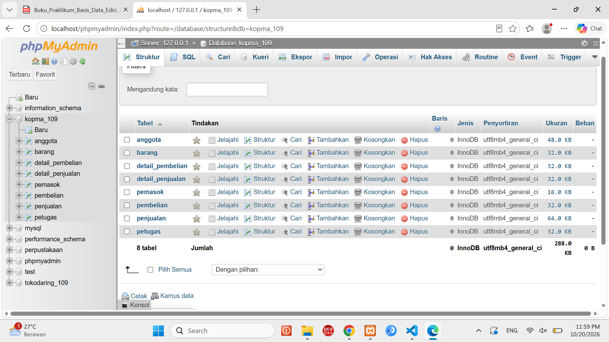
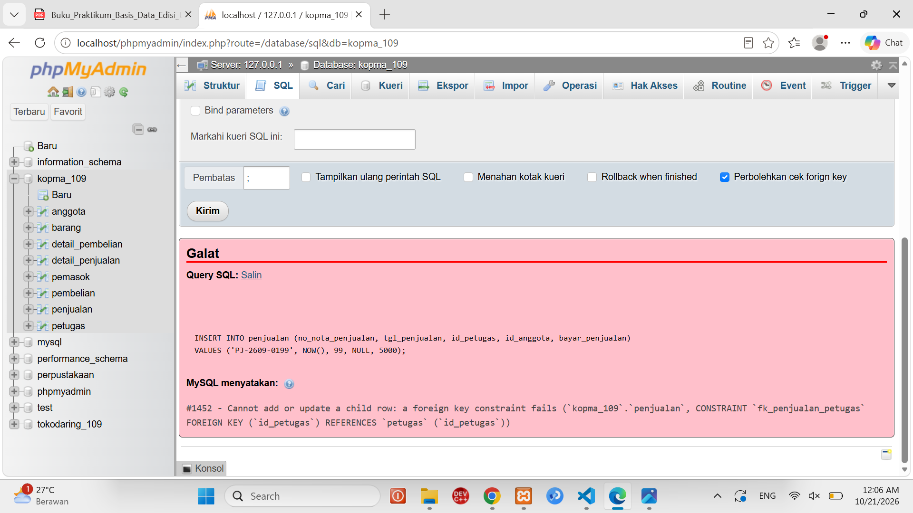
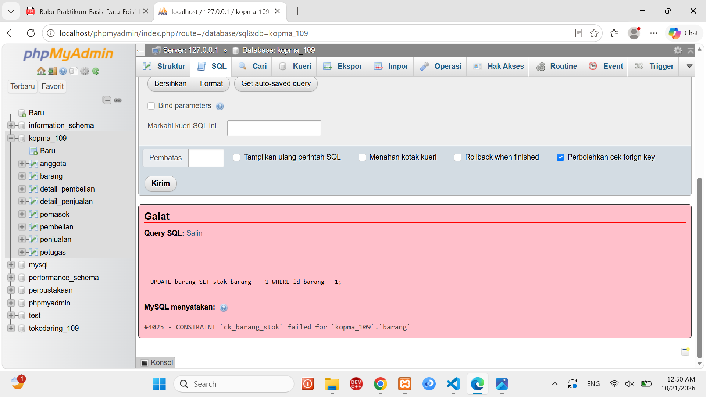
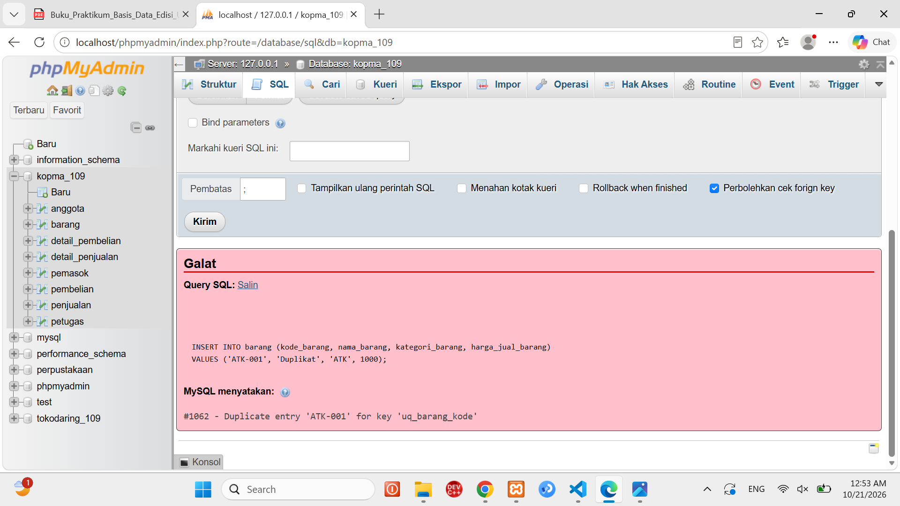
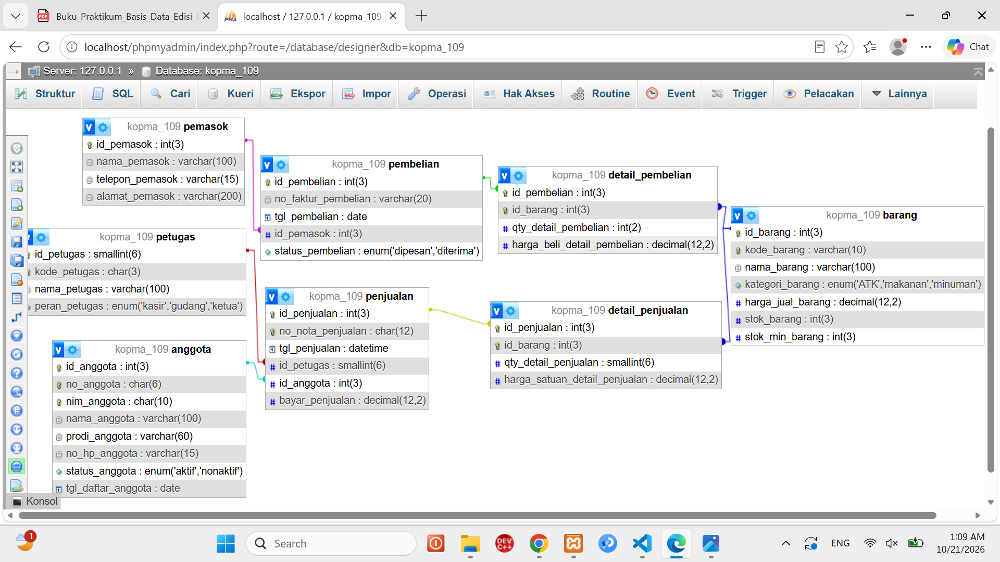

# Laporan Praktikum Basis Data - Pertemuan 05
* **Nama:** **Wanda Talia**
* **Kelas:** **D**
* **NIM:** **25430109**
* **Hari/Tanggal:** **20 Oktober 2026**


### 1. Tujuan Praktikum
Pada pertemuan ini saya belajar:
1. mengubah skema relasional 3NF Kopma menjadi perintah `CREATE TABLE` lengkap dengan tipe data yang sesuai;
2. memasang constraint (PRIMARY KEY, FOREIGN KEY, UNIQUE, NOT NULL, DEFAULT, CHECK) agar aturan bisnis dijaga oleh server;
3. mengubah dan menghapus struktur dengan `ALTER TABLE` dan `DROP TABLE` dalam urutan yang benar;
4. membuktikan constraint benar-benar menolak data salah, lalu mencocokkan desain fisik dengan ERD.

### 2. Ringkasan Dasar Teori

* **DDL** (Data Definition Language) adalah kelompok perintah SQL untuk membuat, mengubah, dan menghapus *struktur* basis data, bukan isinya. Memilih tipe data termasuk keputusan desain: tipe yang terlalu besar memboroskan ruang, tipe yang terlalu kecil menolak data yang sah. Contoh di Kopma: uang memakai `DECIMAL(12,2)` karena `FLOAT` bisa menimbulkan selisih pembulatan; NIM memakai `CHAR(10)` karena berupa kode berpanjang tetap yang tidak dihitung.
* **Constraint** memindahkan aturan bisnis dari "kedisiplinan pengguna" menjadi "jaminan server". `PRIMARY KEY` membuat tiap baris unik dan dapat dikenali, `FOREIGN KEY` menjaga agar data anak selalu merujuk induk yang ada (integritas referensial), `UNIQUE` melarang nilai kembar, `NOT NULL` melarang kosong, `DEFAULT` memberi nilai awal, dan `CHECK` menguji syarat pada satu baris (sejak MariaDB 10.2 benar-benar ditegakkan).
* **Urutan penting:** tabel induk dibuat lebih dulu daripada tabel anak, dan saat menghapus urutannya dibalik (anak dulu, induk belakangan). Kolom kunci tamu harus bertipe sama persis dengan kolom yang dirujuk.

### 3. Hasil Langkah Percobaan
### 3.1 Membuat tabel induk (langkah 1–2)

Berkas `p05_ddl_kopma_109.sql` diawali `USE kopma_109;`. Tabel `petugas`, `anggota`, `barang`, dan `pemasok` dibuat lebih dulu karena tidak memiliki kunci tamu. Nama constraint mengikuti pola `pk_`, `fk_`, `uq_`, `ck_` diikuti nama tabel.

```sql
CREATE TABLE petugas (
  id_petugas    SMALLINT                      NOT NULL AUTO_INCREMENT,
  kode_petugas  CHAR(3)                       NOT NULL,
  nama_petugas  VARCHAR(100)                  NOT NULL,
  peran_petugas ENUM('kasir','gudang','ketua') NOT NULL,
  CONSTRAINT pk_petugas PRIMARY KEY (id_petugas),
  CONSTRAINT uq_petugas_kode UNIQUE KEY (kode_petugas)
) ENGINE=InnoDB;

CREATE TABLE barang (
  id_barang         INT                             NOT NULL AUTO_INCREMENT,
  kode_barang       VARCHAR(10)                     NOT NULL,
  nama_barang       VARCHAR(100)                    NOT NULL,
  kategori_barang   ENUM('ATK','makanan','minuman') NOT NULL,
  harga_jual_barang DECIMAL(12,2)                   NOT NULL,
  stok_barang       INT                             NOT NULL DEFAULT 0,
  stok_min_barang   INT                             NOT NULL DEFAULT 5,
  CONSTRAINT pk_barang PRIMARY KEY (id_barang),
  CONSTRAINT uq_barang_kode UNIQUE KEY (kode_barang),
  CONSTRAINT ck_barang_stok  CHECK (stok_barang >= 0),     -- AB-03
  CONSTRAINT ck_barang_harga CHECK (harga_jual_barang >= 0)
) ENGINE=InnoDB;
```

Tabel `anggota` (dengan `UNIQUE` pada `no_anggota` dan `nim_anggota` untuk AB-05) dan `pemasok` ditulis dengan pola yang sama; skrip lengkapnya ada di berkas `p05_ddl_kopma_109.sql`.



### 3.2 Membuat tabel dengan kunci tamu (langkah 3–4)

Tabel `penjualan`, `detail_penjualan`, `pembelian`, dan `detail_pembelian` dibuat setelah induknya ada. `id_petugas` bertipe `SMALLINT` persis seperti `petugas.id_petugas`, dan `id_anggota` dibuat `NULL` agar nota pembeli umum tetap bisa dicatat (AB-02). `detail_penjualan` memakai kunci primer komposit `(id_penjualan, id_barang)` dan `CHECK (qty_detail_penjualan > 0)`.

```sql
SHOW TABLES;
SHOW CREATE TABLE penjualan;
```

### 3.3 Membuktikan constraint bekerja (langkah 5)

Data induk diisi lebih dulu (dua petugas dan dua barang), lalu tiga perintah yang melanggar aturan dijalankan. Ketiganya harus ditolak.

```sql
-- (1) kunci tamu tak dikenal
INSERT INTO penjualan (no_nota_penjualan, tgl_penjualan, id_petugas, id_anggota, bayar_penjualan)
VALUES ('PJ-2609-0199', NOW(), 99, NULL, 5000);

-- (2) stok negatif (AB-03)
UPDATE barang SET stok_barang = -1 WHERE id_barang = 1;

-- (3) kode barang kembar
INSERT INTO barang (kode_barang, nama_barang, kategori_barang, harga_jual_barang)
VALUES ('ATK-001', 'Duplikat', 'ATK', 1000);
```

[TANGKAPAN LAYAR : pesan galat FK, kode 1452]


[TANGKAPAN LAYAR : pesan galat CHECK, kode 4025]


[TANGKAPAN LAYAR : pesan galat UNIQUE, kode 1062]



**Keterangan:** ketiga perintah ditolak server sehingga tidak ada baris yang berubah; ini membuktikan aturan dijaga di level basis data, bukan hanya di aplikasi.

### 3.4 Mengubah struktur dan membandingkan dengan ERD (langkah 6–8)

Ketua meminta pencatatan tanggal kedaluwarsa. Kolom ditambahkan tanpa membuat ulang tabel, lalu dibatalkan:

```sql
ALTER TABLE barang ADD COLUMN tgl_kedaluwarsa DATE NULL AFTER stok_min_barang;
DESCRIBE barang;
ALTER TABLE barang DROP COLUMN tgl_kedaluwarsa;
DESCRIBE barang;
```

**ERD fisik.** ERD konseptual dari Pertemuan 3 dilengkapi tipe data dan constraint persis seperti skrip DDL (Tabel 5.2 buku: tipe data, constraint, kunci tamu beserta tabel tujuan dan aksi `ON DELETE`, penanda data pribadi, nilai turunan tidak digambar).

### Perbandingan Designer phpMyAdmin dengan ERD

| Aspek | ERD konseptual (Pertemuan 3) | Designer / desain fisik | Perbedaan yang saya temukan |
| :--- | :--- | :--- | :--- |
| **Kunci primer** | Kode alami (mis. no nota) | `id_*` sebagai kunci pengganti; kode alami menjadi `UNIQUE` | Pada ERD konseptual, entitas diidentifikasi langsung oleh atribut bisnis alami seperti `no_nota_penjualan` atau `nim_anggota`. Sedangkan pada Designer/desain fisik, setiap tabel ditambahkan kolom kunci pengganti (*surrogate key*) bertipe numerik `AUTO_INCREMENT` (seperti `id_penjualan`, `id_anggota`) sebagai `PRIMARY KEY` utama, sementara kode alami dijadikan constraint `UNIQUE`. |
| **Tipe data** | Belum ada | Ada pada tiap kolom | ERD konseptual hanya memperlihatkan nama entitas dan nama atributnya tanpa memperhatikan teknis penyimpanan. Pada Designer/desain fisik, setiap kolom secara spesifik diatur tipe data dan presisinya (seperti `INT`, `CHAR(12)`, `DECIMAL(12,2)`, `DATETIME`, atau `ENUM`) sesuai kebutuhan kamus data. |
| **Relasi M:N** | Penjualan–Barang | Dipecah oleh `detail_penjualan` | ERD konseptual memodelkan hubungan banyak-ke-banyak (*Many-to-Many*) secara langsung antara entitas `penjualan` dan `barang`. Pada Designer/desain fisik, relasi tersebut telah ditransformasi dan dipecah menggunakan entitas asosiatif/tabel junction `detail_penjualan` dengan kunci primer komposit (`id_penjualan`, `id_barang`). |
| **Kardinalitas opsional** | Anggota 0..1 ke penjualan | `id_anggota` `NULL` | Pada ERD konseptual, partisipasi opsional ditandai dengan notasi garis Crow's Foot (lingkaran 0..1) yang menyatakan pembeli umum tidak wajib menjadi anggota. Pada Designer/desain fisik, opsionalitas ini direalisasikan dengan mengizinkan atribut kunci tamu `id_anggota` bernilai `NULL` pada tabel `penjualan`. |
| **Nilai turunan (total belanja)** | Tidak ada | Tidak disimpan | Pada ERD konseptual, nilai kalkulasi seperti `subtotal` dan `total_penjualan` dapat dicatat sebagai atribut turunan. Pada Designer/desain fisik hasil normalisasi 3NF, kolom total belanja sengaja tidak disimpan ke dalam tabel operasional MariaDB guna menghindari anomali konsistensi data, dan nilainya dikalkulasi secara dinamis saat kueri dijalankan. |

### 4. Jawaban Titik Analisis
### Titik Analisis 1: `ON DELETE CASCADE` pada `fk_detail_penjualan`, tetapi tidak pada `fk_detail_barang`

`detail_penjualan` adalah bagian yang tidak punya arti tanpa nota induknya: satu nota dan baris-baris rinciannya merupakan satu kesatuan (AB-01). Jika nota dibatalkan, rinciannya harus ikut hilang supaya tidak tertinggal baris yatim yang merujuk nota yang sudah tidak ada. Karena itu `CASCADE` tepat dipakai.

`barang` berbeda: ia tabel master yang dirujuk oleh banyak nota sepanjang waktu. Seandainya penghapusan barang otomatis menghapus semua detailnya, seluruh riwayat penjualan barang itu akan lenyap diam-diam. Akibatnya laporan lama berubah: omzet harian (KI-01) menyusut, daftar barang terlaris (KI-02) dan belanja anggota (KI-04) menjadi salah, harga historis yang dijaga AB-04 hilang, dan nota yang tersisa bisa tidak punya satu pun baris barang sehingga melanggar AB-01. Tanpa `CASCADE` (perilaku bawaan menolak), server menjawab `ERROR 1451` dan barang yang sudah pernah terjual tidak bisa dihapus. Barang yang tidak dijual lagi sebaiknya ditandai, bukan dihapus.

### Titik Analisis 2: Pemetaan kode galat ke aturan bisnis

| Kode galat | Perintah penyebab | Constraint yang bekerja | Aturan yang dilindungi |
|---|---|---|---|
| 1452 | `INSERT penjualan` dengan `id_petugas = 99` | `fk_penjualan_petugas` (FOREIGN KEY) | Integritas referensial: setiap nota wajib punya kasir yang benar-benar ada (permintaan pengurus "jangan sampai ada nota tanpa kasir"); mendukung keabsahan nota pada AB-01 |
| 4025 | `UPDATE barang SET stok_barang = -1` | `ck_barang_stok` (CHECK) | **AB-03**: stok tidak boleh negatif |
| 1062 | `INSERT barang` dengan `kode_barang` `ATK-001` yang sudah ada | `uq_barang_kode` (UNIQUE) | Keunikan identitas barang. Tidak ada AB bernomor khusus untuk kode barang; semangatnya sejenis AB-05 (keunikan NIM) dan AB-01 (keunikan nomor nota) |

**Aturan bisnis yang belum bisa dijaga constraint apa pun:**

- **AB-01 bagian "minimal satu baris barang"**: `CHECK` hanya melihat satu baris dan tidak bisa menghitung baris di tabel lain. Nota tanpa detail tetap bisa tersimpan. Perlu transaksi (Modul 14).
- **AB-02 syarat "anggota harus aktif untuk diskon 5%"**: ketentuan ini melibatkan nilai di tabel `anggota`, padahal `CHECK` tidak dapat merujuk tabel lain. Ditegakkan lewat kueri/aplikasi.
- **AB-03 bagian "penjualan ditolak bila qty melebihi stok"**: `CHECK` hanya menjaga hasil akhir stok. Tidak ada yang otomatis mengurangi stok saat detail dimasukkan; pengurangan harus dikerjakan bersama pencatatan nota dalam satu transaksi.
- **AB-04 harga di nota = harga saat transaksi**: server tidak dapat memaksa nilai `harga_satuan_detail_penjualan` sama dengan `harga_jual_barang` saat itu; yang dijamin hanya kolom tersebut ada dan tidak boleh kosong.
- **AB-06 pesanan dibuat bila stok kurang dari minimum**: aturan proses, bukan aturan nilai kolom.

### Titik Analisis 3: Mengapa `DROP TABLE IF EXISTS` dimulai dari `detail_*`, bukan `petugas`

`petugas` adalah induk yang dirujuk `penjualan` lewat `fk_penjualan_petugas`. Selama tabel anak masih ada, tabel induk tidak boleh dihapus karena baris anak akan kehilangan rujukannya. Karena itu anak harus dihapus lebih dulu: `detail_pembelian` dan `detail_penjualan` (cucu), lalu `pembelian` dan `penjualan`, baru master. Urutan ini adalah kebalikan dari urutan pembuatan.

Jika urutan dibalik (mis. `DROP TABLE petugas;` sebelum `penjualan`), server menolak dengan galat integritas referensial. Pada MariaDB biasanya muncul `ERROR 1451 (23000): Cannot delete or update a parent row: a foreign key constraint fails`. Pesan yang saya dapatkan di layar:

### 5. Hasil Latihan dan Modifikasi
### Latihan E.1: CHECK `stok_min_barang` tidak negatif

```sql
ALTER TABLE barang
  ADD CONSTRAINT ck_barang_stok_min CHECK (stok_min_barang >= 0);

UPDATE barang SET stok_min_barang = -1 WHERE id_barang = 1;   -- ditolak
```

Server menolak `UPDATE` tersebut dengan galat `4025` karena `ck_barang_stok_min` dilanggar. Alasan: batas minimum stok yang negatif tidak bermakna dan akan merusak logika AB-06 serta laporan KI-03 (stok di bawah minimum).

### Latihan E.2: `ON DELETE SET NULL` pada `fk_penjualan_anggota`

```sql
ALTER TABLE penjualan DROP FOREIGN KEY fk_penjualan_anggota;
ALTER TABLE penjualan
  ADD CONSTRAINT fk_penjualan_anggota FOREIGN KEY (id_anggota)
  REFERENCES anggota (id_anggota) ON DELETE SET NULL;
```

Uji: satu anggota uji dibuat beserta satu nota; setelah anggota dihapus, nota tetap ada dan kolom `id_anggota`-nya menjadi `NULL`. Setelah diuji, kunci tamu dikembalikan ke aturan semula (tanpa aksi khusus) agar skema tetap sama dengan ERD fisik.

**Diskusi: apakah perubahan ini sesuai AB-02 dan UU PDP?**

- *Dari sisi AB-02:* secara struktur cocok, sebab AB-02 memang membolehkan penjualan tanpa anggota (`id_anggota` `NULL`). Namun maknanya berubah: nota seorang anggota diam-diam menjadi nota pembeli umum. Konsekuensinya, riwayat diskon 5% yang pernah diberikan tidak lagi bisa ditelusuri ke anggotanya, dan laporan KI-04 (anggota dengan belanja terbesar) kehilangan data historis.
- *Dari sisi UU PDP:* ini sisi yang mendukung. Undang-Undang Pelindungan Data Pribadi (UU No. 27 Tahun 2022) memberi hak kepada subjek data untuk meminta datanya dihapus. Dengan `SET NULL`, data pribadi anggota (di tabel `anggota`) dapat dihapus tanpa ditolak server, dan nota tetap utuh sebagai catatan transaksi. Dengan aturan bawaan, penghapusan anggota akan ditolak `ERROR 1451` selama ia punya nota.
- *Kesimpulan saya:* `SET NULL` layak dipakai hanya bila Kopma memang wajib melayani permintaan penghapusan data pribadi. Untuk penggunaan sehari-hari, lebih aman mempertahankan aturan bawaan dan menonaktifkan anggota lewat `status_anggota = 'nonaktif'` (serta mengosongkan `no_hp_anggota` bila perlu), karena riwayat penjualan tetap lengkap.

### 6. Tugas Mandiri: Milestone Proyek 5
* **Tema Proyek:** Toko Daring (E-Commerce)
* **Nama Organisasi Fiktif:** Toko Online Wanda Store
* **Berkas SQL DDL:** `p05_ddl_25430109.sql`
* **Gambar ERD Fisik:** `p05_erd_fisik_25430109.png`



**Tabel Pemetaan Tipe Data & Constraint Proyek:**

| Nama Tabel | Nama Kolom | Tipe Data & Panjang | Constraint | Kode Aturan Bisnis |
|---|---|---|---|---|
| anggota | id_anggota | INT | PRIMARY KEY, AUTO_INCREMENT | - |
| anggota | nim_anggota | CHAR(10) | UNIQUE, NOT NULL | AB-01 |
| buku | stok_buku | INT | CHECK (stok_buku >= 0) | AB-03 |
| peminjaman | id_anggota | INT | FOREIGN KEY -> anggota(id_anggota) | AB-02 |

### 7. Pembahasan dan Kendala

**Yang berjalan sesuai harapan.** Ketiga pelanggaran constraint ditolak server dengan kode 1452, 4025, dan 1062, sehingga data induk dan stok tetap bersih. Penambahan dan penghapusan kolom lewat `ALTER TABLE` tidak membutuhkan pembuatan ulang tabel.

**Galat yang umum ditemui, cara membacanya, dan cara mengatasinya:**

| Galat | Cara membaca | Cara mengatasi |
|---|---|---|
| `ERROR 1005 errno 150` *Foreign key constraint is incorrectly formed* | Tabel anak gagal dibuat: kunci tamu tidak cocok dengan kolom induk (tipe berbeda, mis. `INT` merujuk `SMALLINT`; tabel induk belum ada; atau kolom induk bukan kunci) | Samakan tipe dan tanda (`UNSIGNED`) persis; buat tabel induk lebih dulu |
| `ERROR 1451` *Cannot delete or update a parent row* | Server sedang menjaga integritas referensial, bukan rusak. Pesan menyebut constraint yang menahan penghapusan | Hapus atau pindahkan data anak dulu; tinjau aksi `ON DELETE` bila aturan bisnis mengizinkan |
| `ERROR 1050` *Table already exists* | Skrip dijalankan dua kali | Tambahkan `DROP TABLE IF EXISTS` di awal skrip, urutan anak ke induk |
| `ERROR 1452` | Baris anak merujuk induk yang tidak ada | Isi data induk dulu atau perbaiki nilai kunci tamu |
| `ERROR 4025` | Baris melanggar `CHECK` | Perbaiki nilai agar memenuhi syarat constraint |
| `ERROR 1062` | Nilai kembar pada kolom `UNIQUE`/`PRIMARY KEY` | Gunakan nilai lain atau ubah baris yang sudah ada |

### 8. Kesimpulan
DDL dan constraint membuat aturan bisnis Kopma dijaga langsung oleh MariaDB: kunci tamu mencegah nota tanpa kasir, `CHECK` mencegah stok negatif, dan `UNIQUE` mencegah kode atau NIM kembar. Tipe data, urutan pembuatan/penghapusan tabel, dan aksi `ON DELETE` adalah keputusan desain yang punya dampak ke riwayat data. Constraint tidak bisa menjaga seluruh aturan (terutama yang lintas baris atau lintas tabel), sehingga sisanya perlu transaksi dan pengujian.

### 9. Pernyataan Penggunaan AI
Saya menggunakan Claude (Anthropic) untuk memahami maksud Modul 5 dan menyusun draf skrip serta kerangka laporan. Semua perintah SQL saya jalankan sendiri di MariaDB (XAMPP), semua tangkapan layar berasal dari komputer saya, dan analisis serta bagian yang saya isi sendiri sudah saya periksa dan sesuaikan dengan hasil percobaan saya.

## 10. Bukti Git
* **Link Repositori:** [https://github.com/wandatalia/basisdata_25430109]


### Lampiran A: Alasan pemilihan tipe data (Tabel pemetaan kamus data → MariaDB)

| Elemen | Tipe | Alasan |
|---|---|---|
| `nim_anggota` | `CHAR(10)` | Panjang selalu 10; kode, bukan angka untuk dihitung |
| `no_nota_penjualan` | `CHAR(12)` | Format tetap `PJ-2609-0142` |
| `harga_jual_barang`, `harga_satuan_detail_penjualan`, `harga_beli_detail_pembelian`, `bayar_penjualan` | `DECIMAL(12,2)` | Uang harus tepat; `FLOAT` menimbulkan galat pembulatan |
| `stok_barang`, `stok_min_barang`, `qty_detail_pembelian` | `INT` | Bilangan bulat; stok bisa besar |
| `qty_detail_penjualan` | `SMALLINT` | Jumlah per baris nota tidak mungkin puluhan ribu |
| `tgl_penjualan` | `DATETIME` | Laporan harian dan jam sibuk butuh tanggal dan jam (KI-01) |
| `tgl_pembelian`, `tgl_daftar_anggota` | `DATE` | Tanggal saja cukup |
| `status_anggota`, `peran_petugas`, `kategori_barang`, `status_pembelian` | `ENUM(...)` | Nilai terbatas dan diketahui |

### Lampiran B: Ringkasan constraint dan aturan bisnis

| Constraint | Tabel | Jenis | AB |
|---|---|---|---|
| `uq_anggota_nim`, `uq_anggota_no` | anggota | UNIQUE | AB-05 |
| `ck_barang_stok` | barang | CHECK `stok_barang >= 0` | AB-03 |
| `ck_barang_harga` | barang | CHECK `harga_jual_barang >= 0` | (validasi nilai) |
| `uq_barang_kode`, `uq_petugas_kode` | barang, petugas | UNIQUE | (identitas) |
| `uq_penjualan_nota` | penjualan | UNIQUE | AB-01 |
| `fk_penjualan_petugas` | penjualan | FOREIGN KEY | (nota wajib ber-kasir) |
| `fk_penjualan_anggota` | penjualan | FOREIGN KEY, boleh NULL | AB-02 |
| `fk_detail_penjualan` | detail_penjualan | FOREIGN KEY, `ON DELETE CASCADE` | AB-01 |
| `fk_detail_barang` | detail_penjualan | FOREIGN KEY | AB-04 (riwayat harga terjaga) |
| `ck_detail_qty` | detail_penjualan | CHECK `qty > 0` | (validasi nilai) |
| `fk_pembelian_pemasok` | pembelian | FOREIGN KEY | AB-06 |
| `fk_dbeli_pembelian`, `fk_dbeli_barang`, `ck_dbeli_qty` | detail_pembelian | FK dan CHECK | AB-06 |


